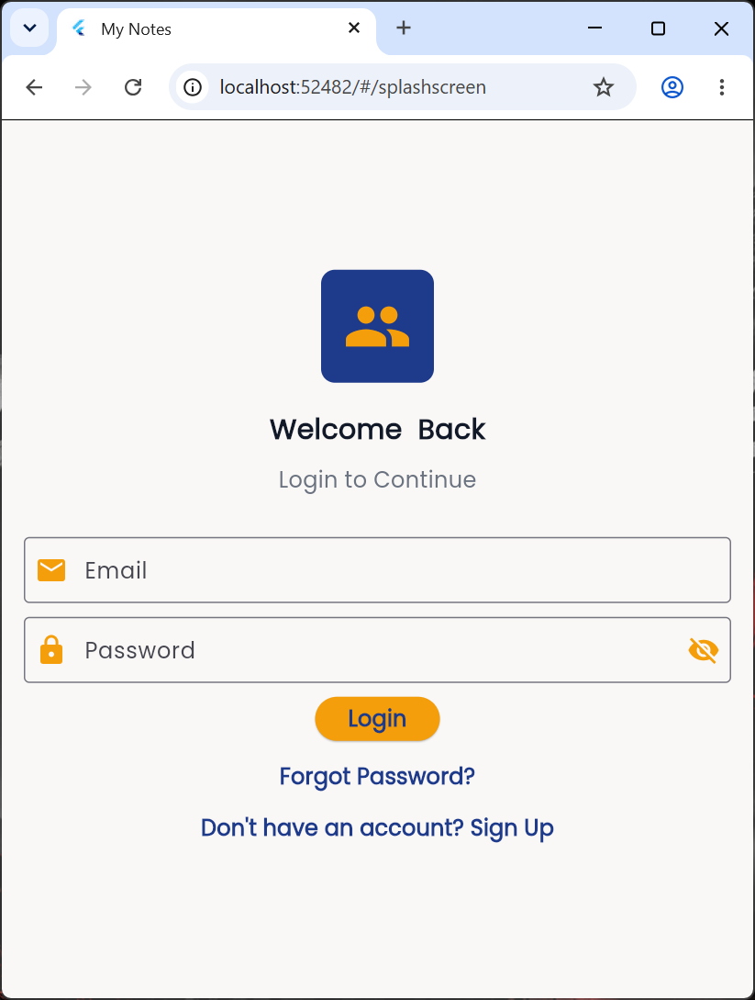
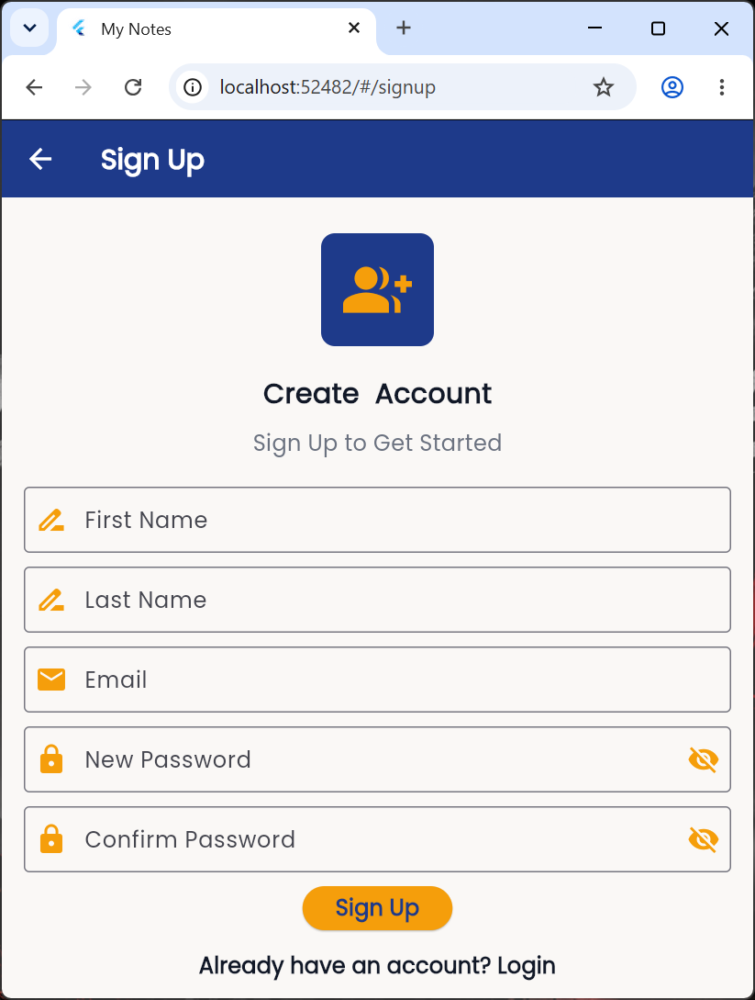
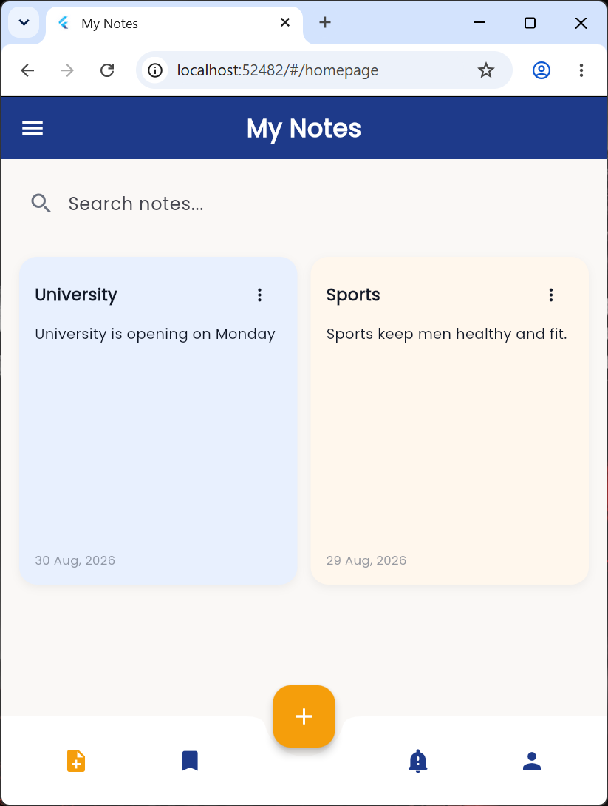
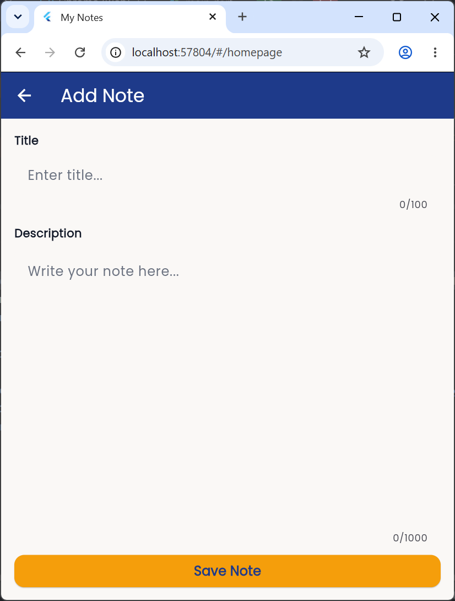
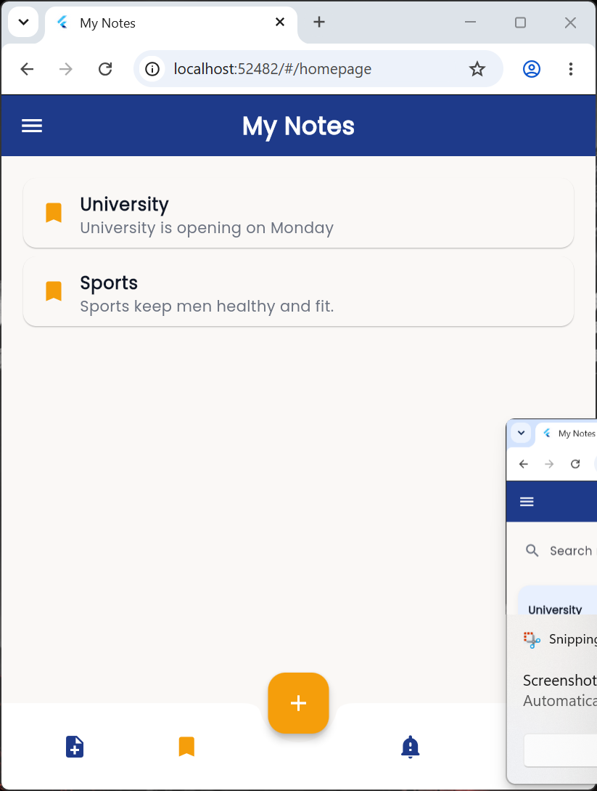
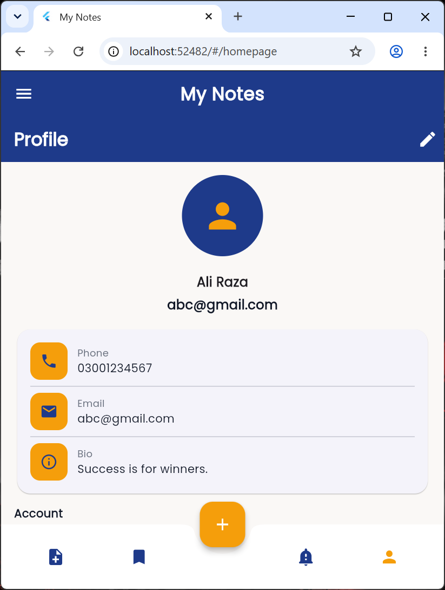
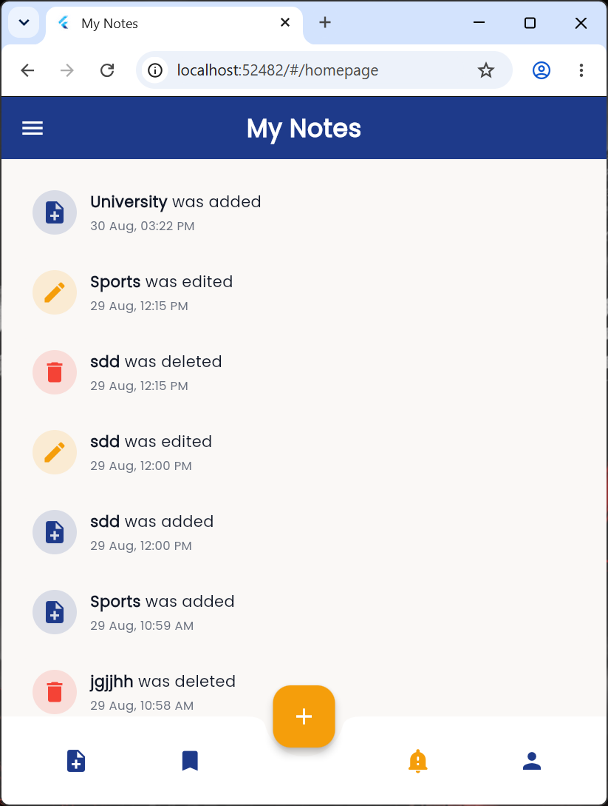
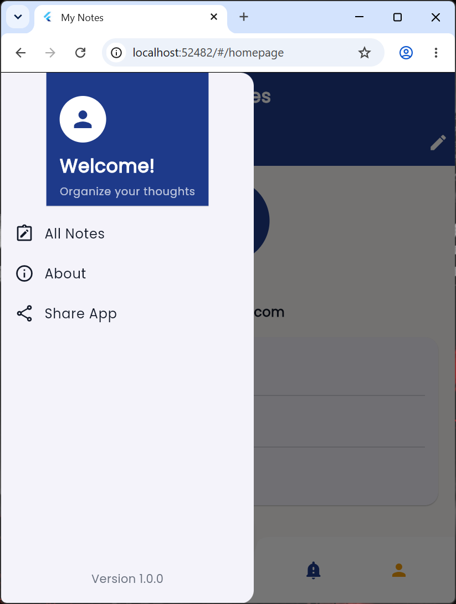

📝 Flutter Note Taking App

A feature-rich note-taking mobile application built with Flutter, Dart, and Firebase. The application provides user authentication, note management, search functionality, bookmarks, activity notifications, profile management, and more.

✨ Features

🔐 Authentication & User Management

- User registration and login.
- Email and password authentication.
- User-specific data management.

📝 Note Management

- Create new notes.
- Edit existing notes.
- Delete notes.
- Search notes.
- Bookmark important notes.
- Manage personal notes.

👤 Profile Management

- View user profile.
- Edit profile information.
- Update account password.

🔔 Notifications & Additional Features

- Notifications when a new note is added.
- Notifications when a note is deleted.
- Share application functionality.
- Privacy Policy option.

🔥 Firebase Integration

- Firebase Authentication for account management.
- Cloud Firestore for storing and managing notes.
- User-specific data organization.

🧰 Tech Stack

| Technology | Purpose |
|---|---|
| Flutter | Cross-platform mobile development |
| Dart | Application programming language |
| Firebase Authentication | User authentication |
| Cloud Firestore | Cloud database |
| Google Fonts | Typography and UI styling |
| Material 3 | Modern user interface |

📱 App Screenshots

| Screen | Screenshot |
|---|---|
| Login Screen |  |
| Sign Up Screen |  |
| Home Screen |  |
| Add Note Screen |  |
| Bookmarks Screen |  |
| Profile Screen |  |
| Notifications Screen |  |
| Drawer |  |

🚀 Getting Started

Prerequisites

- Flutter SDK
- Dart SDK
- Android Studio or VS Code
- Firebase Project
- Git

Installation

1. Clone the repository:

   ```bash
   git clone https://github.com/chaliraza200/Note-app.git
   ```

2. Navigate to the project directory:

   ```bash
   cd Note-app
   ```

3. Install dependencies:

   ```bash
   flutter pub get
   ```

4. Configure Firebase:

   ```bash
   dart pub global activate flutterfire_cli
   flutterfire configure
   ```

5. Run the application:

   ```bash
   flutter run
   ```

🔒 Data Privacy & Authentication Notes

- Firebase Authentication is used for account management.
- Cloud Firestore stores application notes and user-related data.
- User-specific data should be protected through appropriate Firebase Security Rules.
- Firebase configuration is required to run the application.

🔮 Future Improvements

- Profile image upload functionality.
- Advanced note organization and categorization.
- Rich text editing.
- Improved notification management.
- Dark mode support.

👨‍💻 Developer

Developed as a Flutter Note Taking Application using Firebase services.

---

⭐ If you find this project useful, consider giving the repository a star!
